# Architecture: how everything is loaded

This page explains what runs where, in what order an app is loaded (including the `shell` folder), and how the plugin merges
the annotations of the service and of an app into the pages it renders. The diagrams are Mermaid and render on GitHub.

## 1. The pieces

| Piece | Where | Role |
|---|---|---|
| **CAP service** | `srv/*.cds`, `db/` | Data model, `@odata.draft.enabled`, `@readonly`, service-level annotations (`@UI.*`, `@Capabilities.*`) |
| **`cds-htmx` plugin** | `packages/cds-htmx` | Adds a protocol (`@htmx`) beside OData. Runs CQL in-process, renders HTML fragments, streams side effects over SSE |
| **Shell** | `packages/cds-htmx-shell/shell` | A few small JS files that start in the browser: load the theme, htmx, route, open the first page |
| **App** | `app/<name>/webapp` | `manifest.json` (`sap.htmx` or `sap.fe`), optional `annotation.xml`, `i18n`. Contains **no UI code** |
| **Launchpad** (optional) | SAP Work Zone / FLP | Hosts the app through `Component.js` + `flp.js` instead of `index.html` + `standalone.js` |

The browser never receives the model or a UI framework. It receives HTML that the server renders from the model and the
annotations, and htmx swaps it into the page.

## 2. Loading an app

An app is a folder with a `manifest.json` and a tiny `index.html`. The generic UI code is not in the app. It is the shell,
which is either copied into the app's `shell/` folder by the build (`cds-htmx-shell` `scripts/`), or, in development, served
from the shell package under the same URL by the plugin (`cds-plugin.js` `mountShell`). So `/<app>/webapp/index.html` works
without a build.

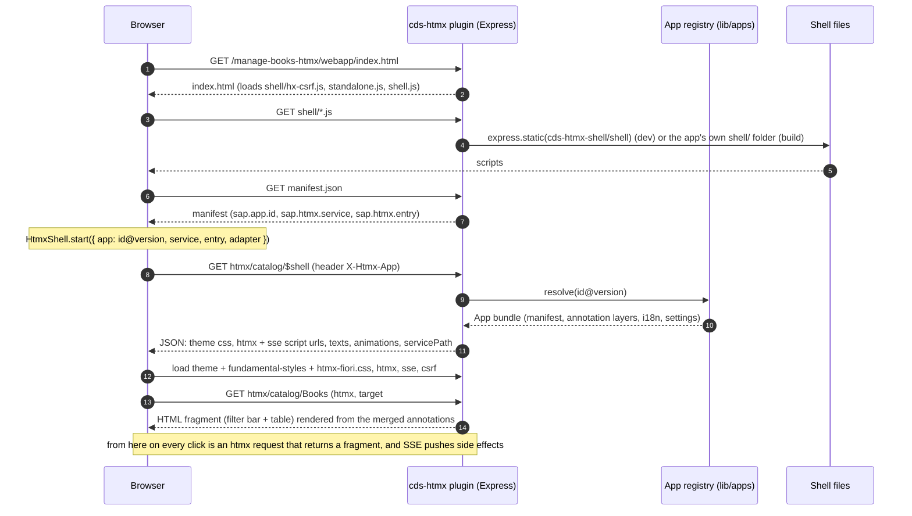

What each step does:

1. **`index.html`** has an empty `#root` and three scripts. It reads `manifest.json`, builds the reference
   `<sap.app.id>@<version>` and calls `HtmxShell.start(...)` with an **adapter**: `standalone` (route in the URL hash) or `flp`
   (route in the launchpad's inner app hash, theme and animation mode from UI5).
2. **`GET $shell`** is the one bootstrap request. The plugin answers with the asset URLs (the theme, `fundamental-styles`,
   the plugin's own CSS and JS, htmx and its SSE extension), the texts, the animation setting and the service path. Nothing is
   hard-coded in the shell, so the plugin and the shell can be updated independently.
3. **The shell** loads the styles first, then htmx, installs the CSRF handling (`hx-csrf.js`: the approuter token is fetched
   once and attached to every write), then fetches the `entry` route into `#app`. htmx decides push versus replace, the shell
   hands the history entry to the adapter.
4. **Every later request** carries `X-Htmx-App: id@version`. The server uses it to pick the app's settings (FCL, animations,
   annotations). A request without it is the standalone, annotation-driven mode: the plugin falls back to the `sap.fe`
   manifests found under `app/`.

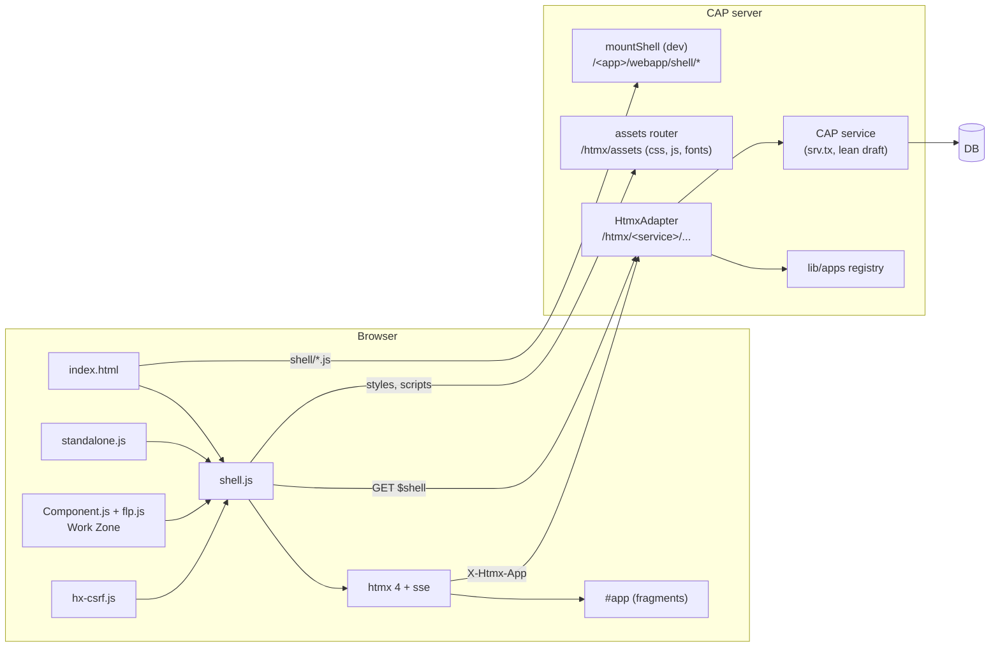

### Where the app comes from

`lib/apps/index.js` resolves `X-Htmx-App` to an `App` bundle. The id pattern is validated before it touches any lookup, and
`cds.htmx.apps.allow` lists the ids that may be served. Sources (`lib/apps/providers`) are tried in order:

| Source | Use |
|---|---|
| `local` | the `webapp/manifest.json` files under `app/`. Development and co-deployed apps. Marked *volatile* outside production: it is re-checked for edits (newest mtime) instead of trusted for a TTL, so `cds watch` picks up an edited `annotation.xml`. A deployed instance (`NODE_ENV=production`) uses the TTL |
| remote kinds | an app deployed elsewhere (see `FRONTEND_DEPLOYMENT_AND_EXTENSIBILITY.md`). Cached with a TTL, refetched when the browser runs another version, an already loaded app is kept when a refresh fails |

Concurrent requests for one app share a single load, and a failed load is remembered for a few seconds.

## 3. How the annotations are merged

The plugin does not read the CDS model's UI annotations directly. It reads the **same merged `$Annotations` that OData
`$metadata` would expose**, plus whatever the app adds, with the same layering rules as Fiori Elements.

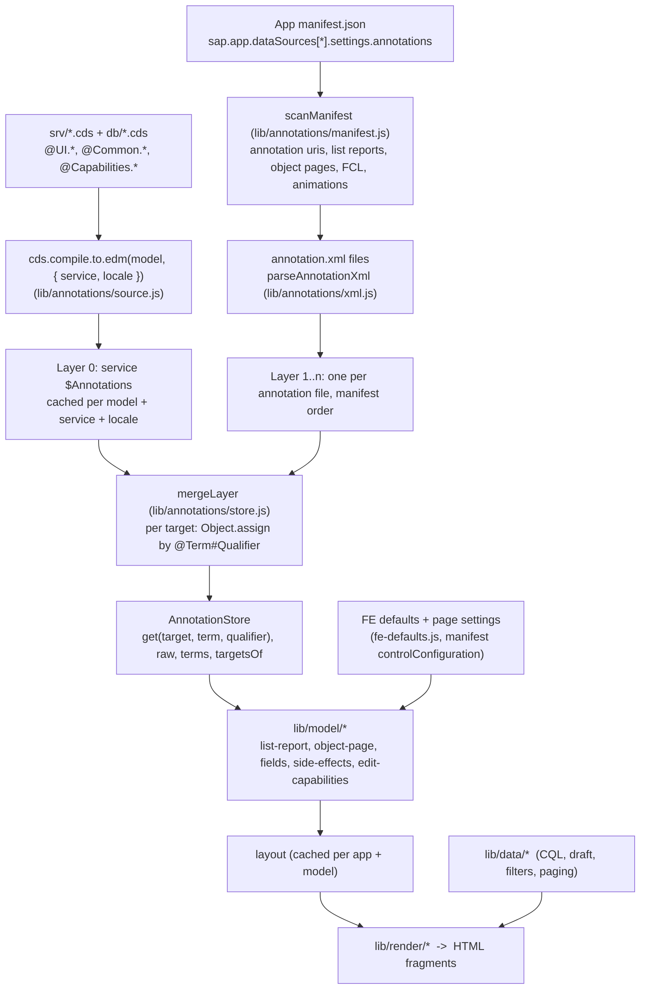

The rules:

1. **Layer 0** is `cds.compile.to.edm(model, { service })`'s `$Annotations`, keyed by target (`CatalogService.Books`,
   `CatalogService.Books/title`). It is compiled once per `cds.model` instance, service and locale, so a `cds watch` reload
   (a new model object) invalidates it.
2. **Layer 1..n** are the `annotation.xml` files the app's manifest declares as annotation data sources for that service,
   **in manifest order**. A pulled app (`X-Htmx-App`) uses *only its own* layers. A request without one is served by the
   *standalone app* (`lib/apps/standalone.js`): the manifests under `app/` that point to the same service path, seen as one
   app with the same interface (`scanFor`, `caches`), so there is one code path for both.
3. **Merging** is `mergeLayer`: for each target, each `@Alias.Term#Qualifier` key from a later layer **replaces** the earlier
   one wholesale. There is no deep merge inside a collection or record. That is how FE layers annotations, so an
   `annotation.xml` that redefines `UI.LineItem` replaces the whole line item of the CDS file, while `UI.LineItem#Books` is a
   different key and sits beside it.
4. **Defaults**: when a term is absent the model builders apply FE's defaults (for example the line items of a table, the
   page size, the facet layout). Page settings come from the manifest: `controlConfiguration` (qualified keys such as
   `awards/@UI.LineItem#Awards`), `contextPath`, `variantManagement`, `initialExpansionLevel`, `$navigation`, `fcl` and
   `sap.htmx.animations`. Those are scoped to the app that asked for them.
5. **Capabilities** are annotations too. `@readonly` and `Capabilities.Insert/Update/DeleteRestrictions` of the target, and
   `Capabilities.NavigationRestrictions` of the parent, decide what a table section offers
   (`model/object-page.js` `sectionCapabilities`). The server refuses what the page does not offer.

The result of the merge is turned into a **layout** (columns, field groups, facets, filters, side effects), cached per app and
model, and then into HTML. Rendering never reads the CDS model directly.

## 4. One request, end to end

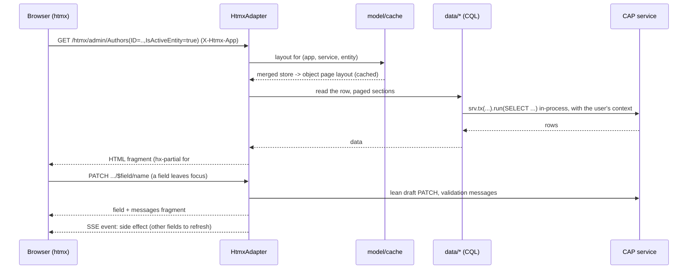

There is no OData round trip: the plugin calls the service in-process through `srv.tx` and the lean draft methods, so
authorisation, handlers and validations of the service apply exactly as for OData, and the log shows `[htmx]` and `[sse]`
lines rather than `[odata]`.

Routes (`lib/HtmxAdapter.js`): `/:Set` (List Report or Object Page), `/:Set/$table`, `$children` (tree), `$export`,
`$delete`, `$edit`, `$save`, `$discard`, `$effects`, `$field/:path`, `$vh/:path` (value help), `$action/:name`,
`/:Set/:nav` (create in a section), and the catch-all sub-object page, nested `PATCH` and `POST`. `GET $shell`, `$events`
(SSE) and `$playground` are the service-level routes. Writes need the `HX-Request` header plus the CSRF token, so a form or
image on another site cannot trigger them.

## 5. Phase 8 in pictures

**Filters, tables and dialogs.** Filter bar with value help, column menu and View Settings are the same widgets as FE.

| | |
|---|---|
| 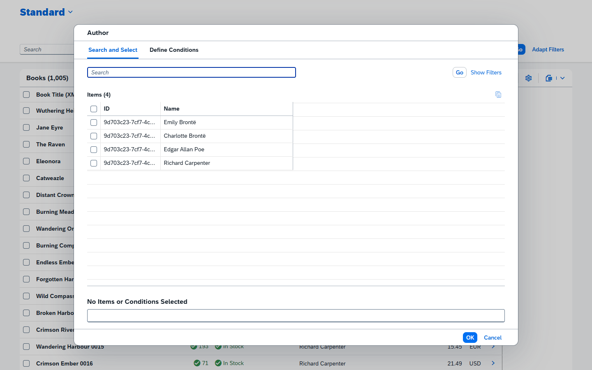 | 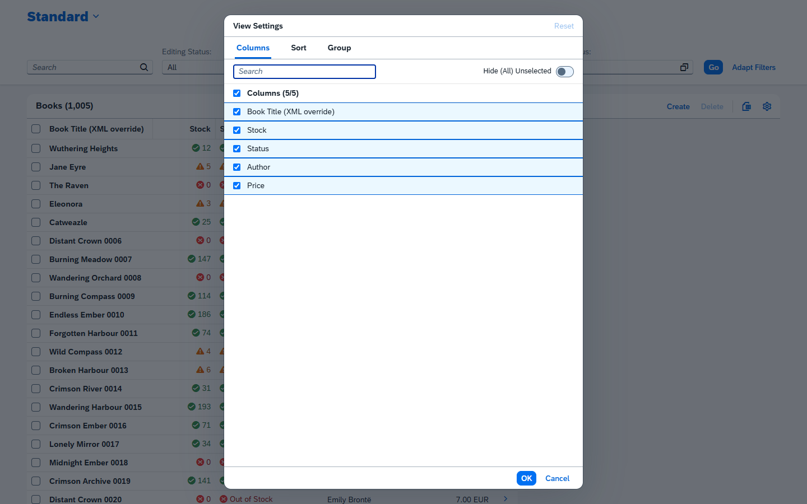 |
| 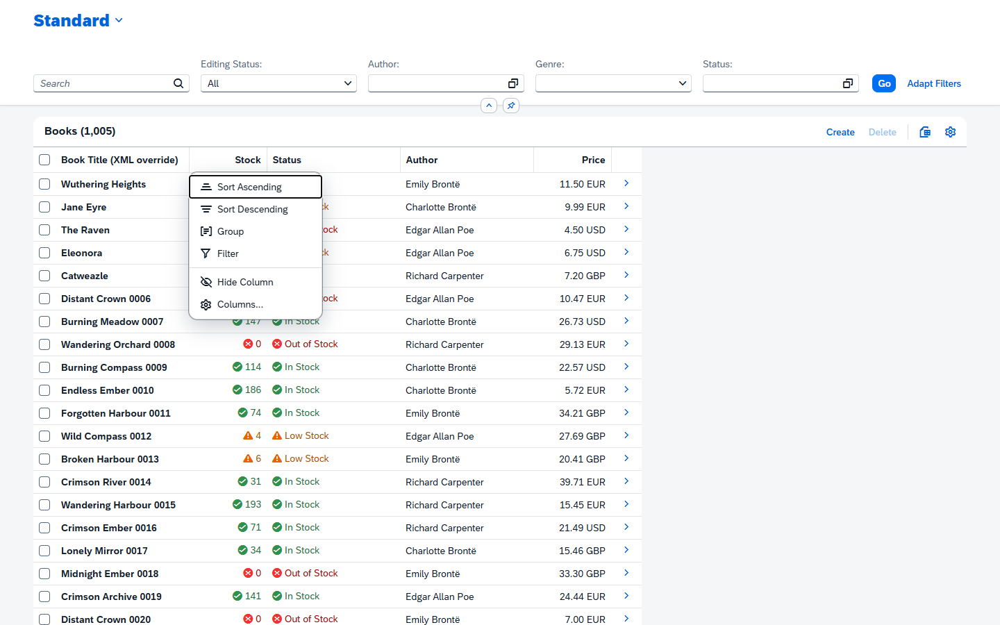 | 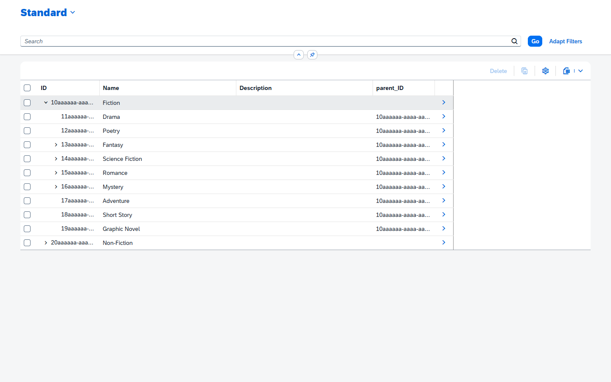 |

**Object Page and drafts.** Edit creates a draft, a field is saved when it loses focus, messages collect in the footer and
Save activates the draft.

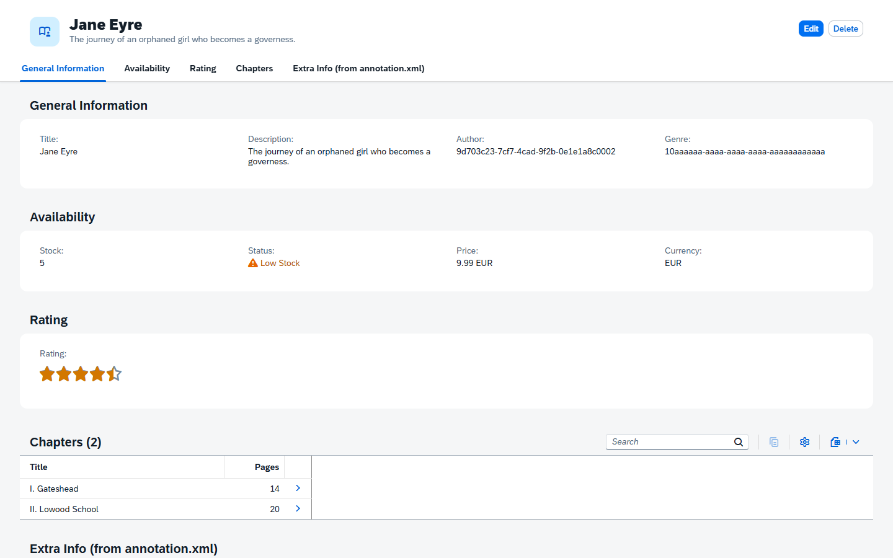
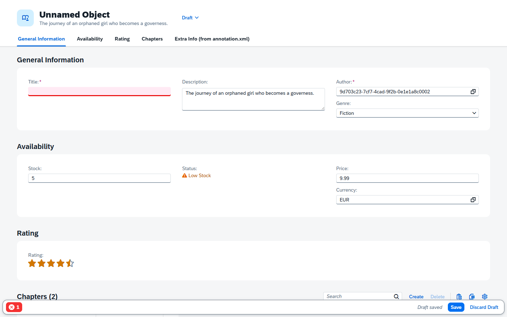

**Column layout.** Author, then an Award in the third column. The sub-object page has Apply instead of Save and its footer is
at the bottom of the column.

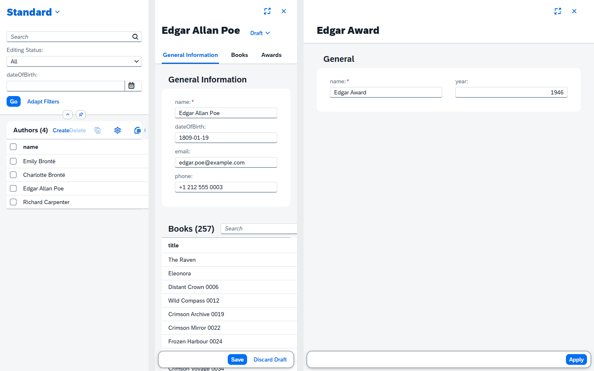

**Themes.** `sap_horizon`, `_dark`, `_hcb`, `_hcw`, or `auto` (follows the browser, also while the page is open). In a
launchpad the theme and animation mode come from UI5.

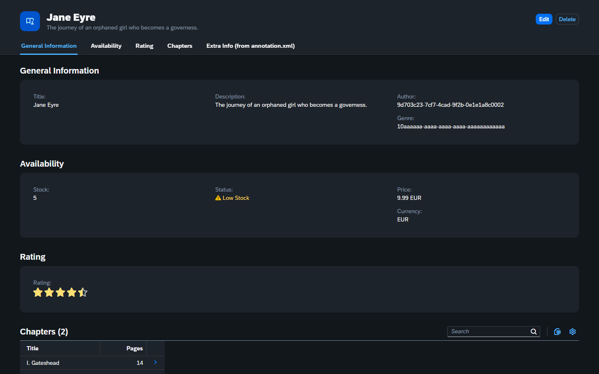

## 6. Where to look in the code

| Question | File |
|---|---|
| Plugin start, dev shell mount, SSE registration | `packages/cds-htmx/cds-plugin.js` |
| Routes, bootstrap info, request logging | `lib/HtmxAdapter.js` |
| Which app, which source, caching | `lib/apps/index.js`, `lib/apps/providers/*`, `lib/apps/bundle.js` |
| Annotation layers | `lib/annotations/{source,xml,manifest,store}.js` |
| Annotations -> layout | `lib/model/*`, cache in `lib/model/cache.js` |
| Layout + data -> HTML | `lib/render/*`, `lib/data/*` |
| Browser start-up | `packages/cds-htmx-shell/shell/{shell,standalone,flp,hx-csrf}.js`, `Component.js` |
