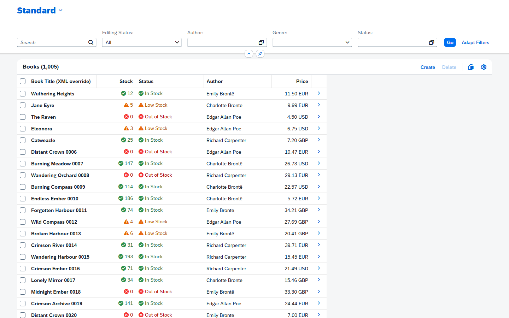

# cds-htmx

`cds-htmx` is a CAP plugin that serves SAP Fiori elements style **List Report** and **Object Page** UIs over **htmx 4**. The server renders HTML from the compiled OData annotations of the service (plus the annotations and the manifest of an app), the browser swaps the fragments in. There is no UI framework in the browser and no UI code in the app.



## Getting started

Requirements: Node.js 20 or later, `@sap/cds` 9 or later.

```sh
npm install
npm run watch          # cds watch
```

Open the sample pages (the SQLite database is in memory):

| URL | What it is |
|---|---|
| `http://localhost:4004/htmx/catalog/Books` | List Report of the catalog service, rendered from its annotations alone |
| `http://localhost:4004/manage-books/webapp/index.html` | The Fiori elements app, to compare side by side |
| `http://localhost:4004/manage-books-htmx/webapp/index.html` | The same app on the htmx shell (a manifest with `sap.htmx`, no UI code) |
| `http://localhost:4004/manage-authors-htmx/webapp/index.html` | Authors in a flexible column layout (List Report, Object Page, sub-object page) |
| `http://localhost:4004/htmx/catalog/$coverage` | Every annotation term of the service and whether the plugin supports it |

### Add it to a project

1. Install the plugin: `npm add cds-htmx`. CAP loads it as a plugin and registers the protocol `@htmx` beside OData.
2. Serve a service over it: `service CatalogService @odata @htmx { ... }`.
3. Open `/htmx/<service>/<EntitySet>`. The List Report is built from `@UI.LineItem`, `@UI.SelectionFields`, `@UI.HeaderInfo`, `@UI.Facets` and the other annotations in the [coverage matrix](annotations.md).
4. To change what a page looks like without touching the model, put an `annotation.xml` and a `manifest.json` in `app/<name>/webapp`. Its annotations are layered on top of the service's, as in Fiori elements.

## Where to go next

| Page | Content |
|---|---|
| [Architecture](ARCHITECTURE.md) | what runs where, how an app is loaded, how annotations are merged |
| [Supported annotations](annotations.md) | the coverage matrix: supported, partial, ignored |
| [Configuration](configuration.md) | every `cds.htmx` option and the app manifest settings |
| [Deploying to BTP and Work Zone](DEPLOY_BTP.md) | entitlements, MTA build, HTML5 app, tile in Work Zone |
| [Frontend deployment and extensibility](FRONTEND_DEPLOYMENT_AND_EXTENSIBILITY.md) | the design of the shell, the app sources and the extension points |
| [Known deviations from Fiori elements](deviations.md) | what differs or is missing on purpose |
| [Open items and roadmap](OPEN_ITEMS_AND_ROADMAP.md) | gaps and future work |
| [Implementation plan](IMPLEMENTATION_PLAN.md) | the phases the project was built in |

## Tests

```sh
npm test            # unit and integration tests (node:test)
npm run test:e2e    # browser tests (Playwright), light and dark theme, including the Fiori elements parity checks (fe-parity.spec.js)
```

On Windows the browser tests use the installed Edge. Set `PW_CHANNEL` to use another installed browser, or leave it unset on Linux and CI to use Playwright's own Chromium.
